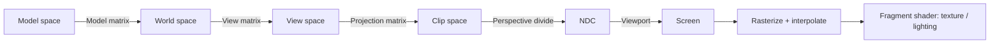

# Computer Graphics Demos (WebGL2 + TypeScript + Vite)

Interactive WebGL2 demos that show the principles and calculations behind rendering. No 3D library is used: matrices, geometry, shaders and textures are all written from scratch.

## Original Requirements

1. **Example 1** - GL shader demo (vertex shader and fragment shader). A simple model is enough; the focus is the principle and calculation of the shader pipeline.
2. **Example 2** - Draw a donut (甜甜圈) with icing (糖霜) and chocolate (朱古力) materials. The demo teaches how to process 3D textures.
3. Each example is a web page in one web project, with build/deploy scripts provided.

## Demos

| Page | Example | What it teaches |
|------|---------|-----------------|
| `index.html` | - | Landing page linking to all demos |
| `vertex-demo.html` | 1 | Model -> View -> Projection transform, flat vertex colors, no lighting |
| `fragment-demo.html` | 1 | Per-fragment Phong lighting (ambient + diffuse + specular) |
| `combined-demo.html` | 1 | Full pipeline with live shader source and matrix display |
| `donut-uv-demo.html` | 2A | Image textures sampled via UVs: filtering, tiling, alpha layers (dough/icing/chocolate), normal map |
| `donut-procedural-demo.html` | 2B | Same donut with every texture computed in the shader: noise/fbm, masks, bump, icing displacement |

### Demo controls

- **Orbit camera** (donut demos): drag to rotate, wheel to zoom.
- **2A (UV)**: toggle icing / chocolate / normal map, choose texture filter, dough tiling (1-24x), light angle; a 2D canvas shows the UV texture.
- **2B (Procedural)**: select view mode (final, dough, icing mask, fbm noise, chocolate mask), icing thickness, light angle.

## Requirements

- Node.js 18+ and npm
- A browser with WebGL2 support

## Quick Start

```bash
npm install
npm run dev          # dev server with hot reload
npm run typecheck    # tsc --noEmit
npm run build        # tsc + vite build -> dist/
npm run preview      # serve dist/
```

### Build / Deploy scripts

```bash
./scripts/build.sh          # install deps if needed, typecheck, clean build into dist/
./scripts/deploy.sh [port]  # rebuild, then serve dist/ locally (default port 4173)
```

`deploy.sh` serves with `vite preview` and is a local deployment only. For real hosting, upload `dist/` to any static host (all assets use relative paths from the Vite build).

## Project Structure

```
graphic_example/
├── index.html, vertex-demo.html, fragment-demo.html, combined-demo.html,
│   donut-uv-demo.html, donut-procedural-demo.html   # one entry page per demo
├── vite.config.ts            # multi-page build (one rollup input per HTML page)
├── tsconfig.json, package.json
├── scripts/                  # build.sh, deploy.sh
├── docs/EXAMPLE1_SPECIFICATION.md   # detailed spec for Example 1
└── src/
    ├── main.ts                        # combined demo
    ├── main-vertex-demo.ts            # Example 1: vertex
    ├── main-fragment-demo.ts          # Example 1: fragment
    ├── main-donut-uv-demo.ts          # Example 2A
    ├── main-donut-procedural-demo.ts  # Example 2B
    ├── demo.css
    ├── glsl.d.ts                      # typings for `?raw` GLSL imports
    ├── shaders/                       # GLSL ES 3.00 sources
    │   ├── vertex.glsl, vertex-simple.glsl
    │   ├── fragment.glsl, fragment-simple.glsl, fragment-lighting.glsl
    │   ├── donut-uv.{vert,frag}.glsl
    │   ├── donut-proc.{vert,frag}.glsl
    │   └── common-noise.glsl          # shared value noise / fbm, prepended to 2B shaders
    ├── geometry/                      # cube.ts, torus.ts (positions, normals, UVs, indices)
    ├── math/matrix.ts                 # perspective, lookAt, rotate, multiply
    ├── textures/generate.ts           # CPU-generated dough/icing/chocolate/normal images (512x512)
    └── webgl/                         # shader-program, mesh, renderer, texture, uniforms, orbit-camera
```

## Architecture

- **Shaders** are plain `.glsl` files imported with Vite's `?raw` suffix; each demo compiles them through `webgl/shader-program.ts`.
- **Geometry** modules return typed arrays; `webgl/mesh.ts` and `webgl/renderer.ts` upload buffers and issue draw calls.
- **Math** is a small hand-written 4x4 matrix library (`math/matrix.ts`).
- **Example 2A vs 2B** deliberately render the same torus two ways: sampled image textures (2A) versus procedural shader math (2B), so the trade-offs are visible side by side.

## Pipeline Summary



## Documentation

- `docs/EXAMPLE1_SPECIFICATION.md` - Example 1 (vertex/fragment shaders)
- `docs/EXAMPLE2_SPECIFICATION.md` - Example 2 (donut texturing: UV image textures vs procedural)

## Known Notes

- `simple-demo.html`, `test-webgl.html` and `src/shaders/vertex-simple.glsl` are not part of the Vite build inputs; they are leftover debug/experiment files.
- No test runner is configured; Example 2 spec section 5 lists manual test cases and proposed Vitest unit tests.
