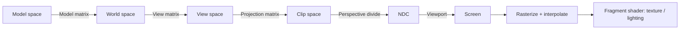

# Computer Graphics Demos (WebGL2 + TypeScript + Vite)

Interactive WebGL2 demos that show the principles and calculations behind rendering. No 3D library is used: matrices, geometry, shaders and textures are all written from scratch.

## Original Requirements

1. **Example 1** - GL shader demo (vertex shader and fragment shader). A simple model is enough; the focus is the principle and calculation of the shader pipeline.
2. **Example 2** - Draw a donut (甜甜圈) with icing (糖霜) and chocolate (朱古力) materials. The demo teaches how to process 3D textures.
3. Each example is a web page in one web project, with build/deploy scripts provided.

## Demos

| Page | Example | What it teaches |
|------|---------|-----------------|
| `index.html` | - | Landing page linking to all demos |
| `vertex-demo.html` | 1 | Model -> View -> Projection transform, flat vertex colors, no lighting |
| `fragment-demo.html` | 1 | Per-fragment Phong lighting (ambient + diffuse + specular) |
| `combined-demo.html` | 1 | Full pipeline with live shader source and matrix display |
| `donut-uv-demo.html` | 2A | Image textures sampled via UVs: filtering, tiling, alpha layers (dough/icing/chocolate), normal map |
| `donut-procedural-demo.html` | 2B | Same donut with every texture computed in the shader: noise/fbm, masks, bump, icing displacement |
| `model-demo.html` | 3 | Model viewer: hand-written GLB (binary glTF) loader for `icecream-van.glb`, plus a procedural KMB double-decker bus with a UV atlas |
| `image-to-3d-demo.html` | 3 | 2D picture -> 3D relief: heuristic or uploaded depth map, displaced grid, edge tearing, GLB export |
| `car-uv-demo.html` | 3 | Models built in code with one painted UV atlas each: car, HK taxi (curved body), KMB bus, building, ship, airplane; UV checker, wireframe overlay, GLB export |
| `flight-sim-demo.html` | 4 | 飛行模擬器: jet over a Hong Kong-style harbour city with flight physics, traffic, jet effects, weather, sound and music |

### Demo controls

- **Orbit camera** (donut and model demos): drag to rotate, wheel to zoom.
- **2A (UV)**: toggle icing / chocolate / normal map, choose texture filter, dough tiling (1-24x), light angle; a 2D canvas shows the UV texture.
- **2B (Procedural)**: select view mode (final, dough, icing mask, fbm noise, chocolate mask), icing thickness, light angle.
- **Model viewer**: choose the GLB van or the KMB bus; view lit / albedo / normals / UVs; the bus shows its UV atlas.
- **Image to 3D**: drop or pick an image, optionally load a depth map (white = near); adjust depth, blur, gamma, resolution, tear edges, solid back; export `.glb`.
- **UV models**: pick a model, change paint colour, switch painted atlas / UV checker, toggle UV wireframe; export `.glb`.

### Flight simulator (`flight-sim-demo.html`)

| Key | Action |
|-----|--------|
| `↑` / `↓` | Climb / descend (flight assist holds a climb rate, then holds altitude on release) |
| `←` / `→` | Turn left / right (assist banks to 55° and levels the wings on release) |
| `A` | Throttle up; afterburner above 85% |
| `Z` / `S` | Throttle down + airbrake |
| `Q` / `E` | Rudder |
| `F` | Toggle flight assist (off = raw pitch / roll) |
| `C` | Chase / cockpit camera (cockpit shows the nose and fuselage) |
| `1` `2` `3` | Weather: sunny 晴天 / cloudy 陰天 / rain 雨天 |
| `M` | Mute sound effects |
| `B` | Background music (YouTube embed) |
| `R` | Reset |

- **Physics** (`src/sim/physics.ts`): rigid body with quaternion orientation at 120 Hz; lift from angle of attack with stall at ~15.5°, parasite + induced drag, side force, thrust, air density falling with altitude; control authority scales with dynamic pressure.
- **City** (`src/sim/city.ts`): island + harbour + Kowloon side; box, cylinder, polygon, stepped, spire and cruciform residential towers with per-building facade colours; IFC / Bank of China / Central Plaza / ICC-style landmarks; container port with gantry cranes; hills; ships in the harbour. All surfaces use repeating canvas-painted UV textures.
- **Traffic** (`src/sim/traffic.ts`): 160 taxis (red / green / blue) and private cars drive the road grid, turn randomly at junctions, keep left and stop at "red lights".
- **Effects** (`src/sim/effects.ts`): particle jet flame, afterburner shock diamonds, contrails above 700 m, crash explosions.
- **Weather** (`src/sim/weather.ts`): sky with sun and fbm clouds, fog, wet reflective ground, rain streaks, lightning; presets blend smoothly.
- **Sound** (`src/sim/audio.ts`): Web Audio synthesis (engine, turbine whine, afterburner, wind, rain, thunder, explosion, stall horn). Starts after the first key press or click.
- **Music** (`src/sim/music.ts`): streams the YouTube video through the official IFrame player (no download). Needs internet, and the video owner must allow embedding.

## Requirements

- Node.js 18+ and npm
- A browser with WebGL2 support

## Quick Start

```bash
npm install
npm run dev          # dev server with hot reload
npm run typecheck    # tsc --noEmit
npm run build        # tsc + vite build -> dist/
npm run preview      # serve dist/
```

### Build / Deploy scripts

```bash
./scripts/build.sh          # install deps if needed, typecheck, clean build into dist/
./scripts/deploy.sh [port]  # rebuild, then serve dist/ locally (default port 4173)
```

`deploy.sh` serves with `vite preview` and is a local deployment only. For real hosting, upload `dist/` to any static host (all assets use relative paths from the Vite build).

## Project Structure

```
graphic_example/
├── index.html, vertex-demo.html, fragment-demo.html, combined-demo.html,
│   donut-uv-demo.html, donut-procedural-demo.html,
│   model-demo.html, image-to-3d-demo.html, car-uv-demo.html,
│   flight-sim-demo.html                             # one entry page per demo
├── public/icecream-van.glb   # 18.6 MB model, copied to dist/ as is
├── vite.config.ts            # multi-page build (one rollup input per HTML page)
├── tsconfig.json, package.json
├── scripts/                  # build.sh, deploy.sh
├── docs/EXAMPLE1_SPECIFICATION.md   # detailed spec for Example 1
└── src/
    ├── main.ts                        # combined demo
    ├── main-vertex-demo.ts            # Example 1: vertex
    ├── main-fragment-demo.ts          # Example 1: fragment
    ├── main-donut-uv-demo.ts          # Example 2A
    ├── main-donut-procedural-demo.ts  # Example 2B
    ├── main-model-demo.ts             # GLB van / KMB bus viewer
    ├── main-image-to-3d-demo.ts       # 2D picture -> 3D relief
    ├── main-car-uv-demo.ts            # UV atlas model gallery
    ├── main-flight-sim.ts             # flight simulator
    ├── loaders/glb.ts                 # GLB parser: chunks, accessors, node transforms, embedded PNG
    ├── image3d/                       # depth estimation, relief mesh, GLB exporter
    ├── models/                        # atlas.ts + builder.ts (box, cylinder, parametric surface)
    │                                  # car, hk-taxi, kmb-bus, building, ship, airplane
    ├── sim/                           # flight sim: physics, city, city-builder, city-textures,
    │                                  # traffic, particles, effects, weather, audio, music, scene-renderer
    ├── demo.css
    ├── glsl.d.ts                      # typings for `?raw` GLSL imports
    ├── shaders/                       # GLSL ES 3.00 sources
    │   ├── vertex.glsl, vertex-simple.glsl
    │   ├── fragment.glsl, fragment-simple.glsl, fragment-lighting.glsl
    │   ├── donut-uv.{vert,frag}.glsl
    │   ├── donut-proc.{vert,frag}.glsl
    │   ├── common-noise.glsl          # shared value noise / fbm, prepended to 2B shaders
    │   ├── model.{vert,frag}.glsl     # textured models: lit / albedo / normals / UVs
    │   └── sim-{world,sky,particle,rain}.{vert,frag}.glsl   # flight sim
    ├── geometry/                      # cube.ts, torus.ts (positions, normals, UVs, indices)
    ├── math/matrix.ts                 # perspective, lookAt, rotate, multiply
    ├── textures/generate.ts           # CPU-generated dough/icing/chocolate/normal images (512x512)
    └── webgl/                         # shader-program, mesh, renderer, texture, uniforms, orbit-camera
```

## Architecture

- **Shaders** are plain `.glsl` files imported with Vite's `?raw` suffix; each demo compiles them through `webgl/shader-program.ts`.
- **Geometry** modules return typed arrays; `webgl/mesh.ts` and `webgl/renderer.ts` upload buffers and issue draw calls.
- **Math** is a small hand-written 4x4 matrix library (`math/matrix.ts`).
- **Example 2A vs 2B** deliberately render the same torus two ways: sampled image textures (2A) versus procedural shader math (2B), so the trade-offs are visible side by side.
- **UV atlas models** (`src/models/`): each model is a `ModelDef` with atlas regions, canvas painters and a `build()` function. Each region has the same aspect ratio as its face in metres, so the paint is not stretched. The UV, model, image-to-3D and flight sim demos share the same models, and they export to GLB through `image3d/glb-export.ts`.
- **Meshes** accept optional tangents and per-vertex colours, 16- or 32-bit indices, and `dispose()`.

## Pipeline Summary



## Documentation

- `docs/EXAMPLE1_SPECIFICATION.md` - Example 1 (vertex/fragment shaders)
- `docs/EXAMPLE2_SPECIFICATION.md` - Example 2 (donut texturing: UV image textures vs procedural)

## Known Notes

- `simple-demo.html`, `test-webgl.html` and `src/shaders/vertex-simple.glsl` are not part of the Vite build inputs; they are leftover debug/experiment files.
- No test runner is configured; Example 2 spec section 5 lists manual test cases and proposed Vitest unit tests.
- The image-to-3D depth is a brightness/saturation heuristic, not an ML model; load a real depth map for accurate results.
- Pushing `public/icecream-van.glb` over HTTPS may need a larger buffer: `git -c http.postBuffer=524288000 push`.
