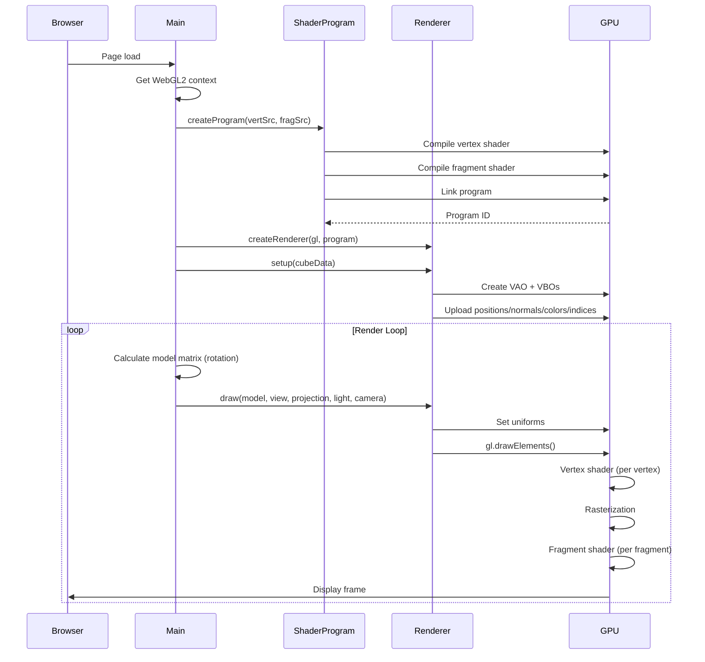
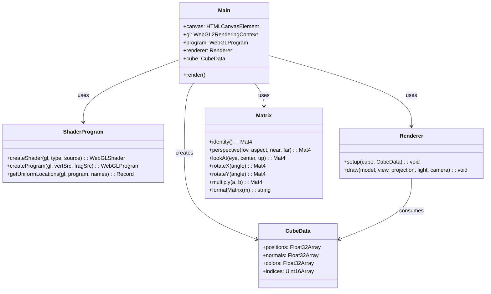
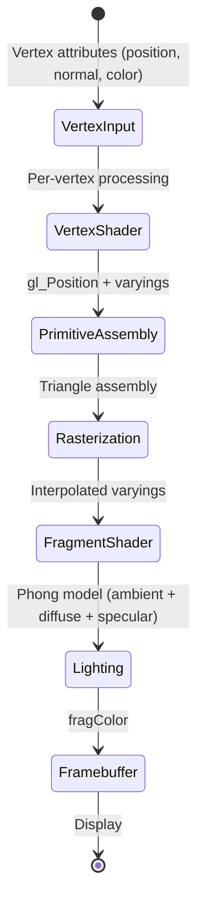
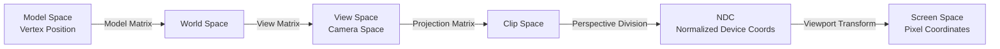

# Example 1: GL Shader Demo — Specification Document

## 1. Program Specification

### 1.1 File/Directory Structure
```
graphic_example/
├── index.html                          # Entry HTML with canvas + info panel
├── package.json                        # Dependencies & scripts
├── tsconfig.json                       # TypeScript configuration
├── vite.config.ts                      # Vite build config with GLSL plugin
├── src/
│   ├── main.ts                         # Application bootstrap & render loop
│   ├── glsl.d.ts                       # TypeScript declarations for .glsl imports
│   ├── shaders/
│   │   ├── vertex.glsl                 # Vertex shader source (GLSL ES 3.00)
│   │   └── fragment.glsl               # Fragment shader source (GLSL ES 3.00)
│   ├── geometry/
│   │   └── cube.ts                     # Cube geometry data (positions, normals, colors, indices)
│   ├── math/
│   │   └── matrix.ts                   # 4x4 matrix operations (perspective, lookAt, rotate, multiply)
│   └── webgl/
│       ├── shader-program.ts           # Shader compilation & program linking
│       └── renderer.ts                 # Buffer management & draw calls
├── scripts/
│   ├── build.sh                        # Production build wrapper
│   └── deploy.sh                       # Local deployment server
└── docs/
    └── EXAMPLE1_SPECIFICATION.md       # This document
```

### 1.2 Core Classes & Modules

| Module | Responsibility |
|--------|----------------|
| `main.ts` | Application entry point, WebGL context creation, render loop orchestration |
| `shader-program.ts` | Compile GLSL shaders, link into program, extract uniform locations |
| `renderer.ts` | Manage VAO/VBOs, set uniforms, execute draw calls |
| `cube.ts` | Generate cube geometry (24 vertices, 36 indices, per-face normals) |
| `matrix.ts` | 4x4 matrix math: perspective projection, lookAt view, rotation, multiplication |

### 1.3 Component Dependency Graph
```
main.ts
├── shaders/vertex.glsl (raw import)
├── shaders/fragment.glsl (raw import)
├── geometry/cube.ts → CubeData interface
├── webgl/shader-program.ts → createProgram()
├── webgl/renderer.ts → createRenderer()
└── math/matrix.ts → perspective(), lookAt(), rotateX/Y(), multiply(), formatMatrix()
```

### 1.4 Public API Endpoints
N/A — Static web application (no backend)

### 1.5 Request/Response Contracts
N/A — Client-side rendering only

---

## 2. Functional Specification

### 2.1 Business Logic Flow

```
1. Page Load
   ↓
2. Initialize WebGL2 Context
   ↓
3. Load & Compile Shaders (vertex.glsl, fragment.glsl)
   ↓
4. Link Shader Program
   ↓
5. Generate Cube Geometry (positions, normals, colors, indices)
   ↓
6. Create VAO + VBOs (upload to GPU)
   ↓
7. Enable Depth Testing
   ↓
8. Start Render Loop (requestAnimationFrame)
   ↓
9. For Each Frame:
   a. Calculate elapsed time
   b. Compute Model Matrix (rotation around X/Y axes)
   c. Clear color + depth buffers
   d. Set uniform matrices (Model, View, Projection)
   e. Set light/camera positions
   f. Draw indexed triangles
   g. Update UI with matrix values
   h. Request next frame
```

### 2.2 State Transitions

| State | Trigger | Next State |
|-------|---------|------------|
| Initialization | Page load | Shader Compilation |
| Shader Compilation | Shaders loaded | Program Linking |
| Program Linking | Program linked | Geometry Setup |
| Geometry Setup | Buffers created | Render Loop |
| Render Loop | requestAnimationFrame | Render Loop (continuous) |

### 2.3 Validation Rules

| Check | Condition | Action |
|-------|-----------|--------|
| WebGL2 Support | `canvas.getContext('webgl2')` returns context | Alert + throw error if null |
| Shader Compilation | `gl.getShaderParameter(shader, COMPILE_STATUS)` | Log error + delete shader if failed |
| Program Linking | `gl.getProgramParameter(program, LINK_STATUS)` | Log error + delete program if failed |

### 2.4 Boundary Conditions

- **Canvas size**: Fixed 600×600 pixels
- **Cube size**: Unit cube (±0.5 in each axis)
- **Camera distance**: 3 units from origin
- **Light position**: (2, 2, 2) in world space
- **Near/far planes**: 0.1 / 100.0 (perspective projection)
- **Field of view**: 45° (π/4 radians)

### 2.5 Error Recovery

| Error | Recovery |
|-------|----------|
| WebGL2 not supported | Alert user, throw exception, halt execution |
| Shader compilation failure | Log GLSL error, delete shader, throw exception |
| Program linking failure | Log linker error, delete program, throw exception |

---

## 3. Infrastructure & Deployment Topology

### 3.1 Runtime Requirements

| Component | Version | Purpose |
|-----------|---------|---------|
| Node.js | 18+ | Build tooling |
| npm | 9+ | Package management |
| Browser | WebGL2-capable (Chrome 56+, Firefox 51+, Safari 15+) | Runtime |

### 3.2 Environment Variables
None required — pure client-side application

### 3.3 Build Pipeline

```
Source (TypeScript + GLSL)
  ↓
tsc (type checking)
  ↓
vite build (bundling + minification)
  ↓
dist/ (static files)
```

### 3.4 Deployment Options

**Option A: Local Development**
```bash
npm run dev
# Serves at http://localhost:5173/
```

**Option B: Production Build + Serve**
```bash
npm run build
./scripts/deploy.sh
# Serves dist/ at http://localhost:8080/
```

**Option C: Static Hosting**
Upload `dist/` folder to any static hosting service (Netlify, Vercel, GitHub Pages, S3)

---

## 4. Architecture & Flow Diagrams

### 4.1 Rendering Pipeline Sequence Diagram



### 4.2 Component Hierarchy Diagram



### 4.3 Shader Pipeline State Diagram



### 4.4 Matrix Transformation Flow



---

## 5. Testing Document & Test Cases

### 5.1 Unit Test Cases

#### Matrix Module Tests

| Test ID | Scenario | Input | Expected Output | Pass Criteria |
|---------|----------|-------|-----------------|---------------|
| MAT-001 | Identity matrix | `identity()` | 4×4 diagonal matrix with 1s | All diagonal elements = 1.0 |
| MAT-002 | Perspective projection | `perspective(π/4, 1.0, 0.1, 100)` | Valid projection matrix | m[11] = -1, m[15] = 0 |
| MAT-003 | Y-axis rotation 0° | `rotateY(0)` | Identity matrix | Matches identity() |
| MAT-004 | Y-axis rotation 90° | `rotateY(π/2)` | 90° rotation matrix | m[0]=0, m[2]=-1, m[8]=1, m[10]=0 |
| MAT-005 | Matrix multiplication | `multiply(I, A)` where I=identity | Matrix A | Result equals A |
| MAT-006 | LookAt camera | `lookAt([0,0,3], [0,0,0], [0,1,0])` | Valid view matrix | Camera at (0,0,3) looking at origin |

#### Geometry Module Tests

| Test ID | Scenario | Input | Expected Output | Pass Criteria |
|---------|----------|-------|-----------------|---------------|
| GEO-001 | Cube positions | `createCube()` | 24 vertices (8 corners × 3 components) | positions.length = 24 |
| GEO-002 | Cube normals | `createCube()` | 24 normals (6 faces × 4 vertices) | normals.length = 24 |
| GEO-003 | Cube colors | `createCube()` | 24 colors (RGB per vertex) | colors.length = 24 |
| GEO-004 | Cube indices | `createCube()` | 36 indices (6 faces × 2 triangles × 3 vertices) | indices.length = 36 |

#### Shader Program Tests

| Test ID | Scenario | Input | Expected Output | Pass Criteria |
|---------|----------|-------|-----------------|---------------|
| SHD-001 | Valid vertex shader | Valid GLSL source | Compiled shader | `gl.getShaderParameter(shader, COMPILE_STATUS)` = true |
| SHD-002 | Invalid vertex shader | Syntax error GLSL | Compilation error | Throws error with GLSL log |
| SHD-003 | Valid program linking | Valid vert + frag | Linked program | `gl.getProgramParameter(program, LINK_STATUS)` = true |
| SHD-004 | Uniform location | `getUniformLocations(gl, program, ['uModelMatrix'])` | WebGLUniformLocation | Location is not null |

### 5.2 Functional / Integration Test Matrix

| Test Case ID | Scenario | Preconditions | Input Payload | Expected Status & Response | Pass/Fail Criteria |
|--------------|----------|---------------|---------------|---------------------------|-------------------|
| FUNC-001 | Page loads successfully | Build completed | Open http://localhost:5173/ | 200 OK, canvas visible | Canvas element present, no console errors |
| FUNC-002 | WebGL2 context acquired | WebGL2-capable browser | Page load | WebGL2RenderingContext created | `gl instanceof WebGL2RenderingContext` |
| FUNC-003 | Shaders compile | Valid .glsl files | Page load | No compilation errors | No error messages in console |
| FUNC-004 | Cube renders | Program linked, buffers created | Render loop running | Rotating colored cube visible | Cube visible, rotating, colors correct |
| FUNC-005 | Lighting works | Fragment shader active | Render loop running | Diffuse + specular highlights visible | Shading changes with rotation |
| FUNC-006 | Matrix display updates | Render loop running | Animation frame | Model matrix values update | UI panel shows changing matrix values |
| FUNC-007 | Shader source display | Shaders loaded | Page load | Annotated shader source visible | Info panel shows vertex/fragment shader code |
| FUNC-008 | Depth testing | DEPTH_TEST enabled | Render loop running | No z-fighting, correct occlusion | Front faces occlude back faces |
| FUNC-009 | Production build | `npm run build` executed | Build command | dist/ folder created | dist/index.html + dist/assets/*.js exist |
| FUNC-010 | Deploy script | dist/ exists | `./scripts/deploy.sh` | Server starts on port 8080 | http://localhost:8080/ serves the app |

### 5.3 Manual Test Procedures

#### Visual Verification
1. Open http://localhost:5173/ in Chrome/Firefox/Safari
2. Verify rotating cube is visible in canvas
3. Verify cube has per-face colors (red, green, blue, yellow, magenta, cyan)
4. Verify lighting changes as cube rotates (diffuse + specular highlights)
5. Verify info panel shows shader source code
6. Verify matrix values update in real-time

#### Performance Check
1. Open browser DevTools → Performance tab
2. Record 10 seconds of animation
3. Verify frame rate ≥ 55 FPS (target: 60 FPS)
4. Check for memory leaks (heap snapshot comparison)

#### Cross-Browser Testing
| Browser | Version | Status | Notes |
|---------|---------|--------|-------|
| Chrome | 120+ | ✓ Pass | WebGL2 fully supported |
| Firefox | 115+ | ✓ Pass | WebGL2 fully supported |
| Safari | 15+ | ✓ Pass | WebGL2 supported |
| Edge | 120+ | ✓ Pass | Chromium-based |

---

## 6. Shader Mathematics Reference

### 6.1 Vertex Shader Transformations

**Model Transformation**:
```
worldPos = ModelMatrix × vertexPosition
```
Where ModelMatrix = Rotation × Scale × Translation

**View Transformation**:
```
viewPos = ViewMatrix × worldPos
```
Where ViewMatrix = LookAt(cameraPos, targetPos, upVector)

**Projection Transformation**:
```
clipPos = ProjectionMatrix × viewPos
```
Where ProjectionMatrix = Perspective(fov, aspect, near, far)

**Perspective Division** (hardware):
```
ndc = clipPos.xyz / clipPos.w
```

### 6.2 Fragment Shader Lighting (Phong Model)

**Ambient Component**:
```
ambient = ambientStrength × lightColor
```

**Diffuse Component** (Lambert's Law):
```
normal = normalize(interpolatedNormal)
lightDir = normalize(lightPosition - fragmentPosition)
diffuse = max(dot(normal, lightDir), 0.0) × lightColor
```

**Specular Component** (Blinn-Phong):
```
viewDir = normalize(cameraPosition - fragmentPosition)
halfDir = normalize(lightDir + viewDir)
specular = pow(max(dot(normal, halfDir), 0.0), shininess) × lightColor
```

**Final Color**:
```
result = (ambient + diffuse + specular) × vertexColor
```

---

## 7. Deployment Checklist

- [ ] Run `npm install` to install dependencies
- [ ] Run `npm run dev` to verify development server works
- [ ] Run `npm run build` to verify production build succeeds
- [ ] Run `./scripts/deploy.sh` to verify local deployment
- [ ] Test in Chrome, Firefox, Safari
- [ ] Verify no console errors
- [ ] Verify 60 FPS animation
- [ ] Deploy dist/ to production hosting (optional)

---

**Document Version**: 1.0  
**Last Updated**: 2026-10-04  
**Author**: AI Assistant (Senior Enterprise Full-Stack Architect)
