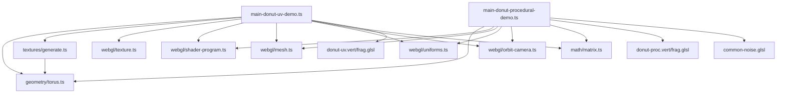
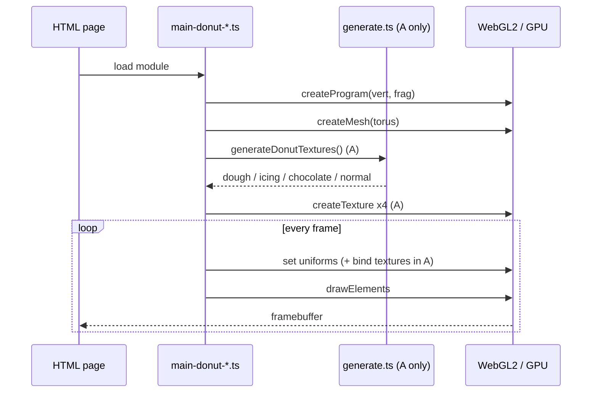
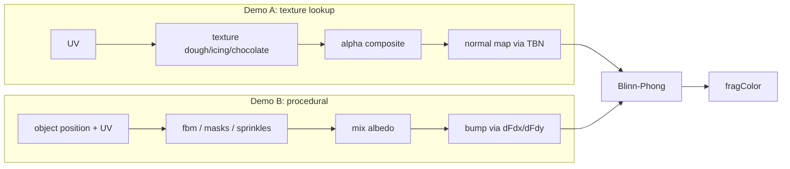
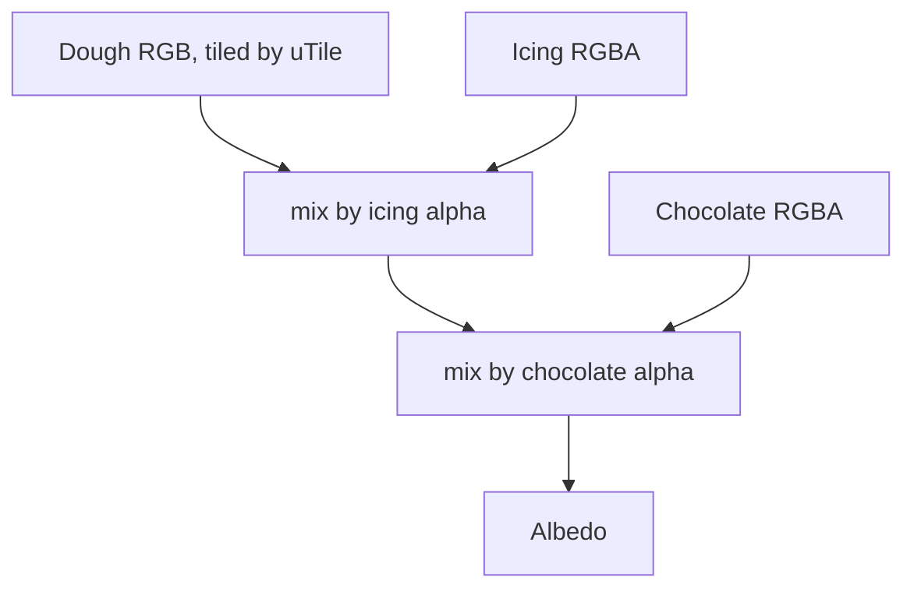

# Example 2: Donut Texturing Demo - Specification Document

Goal: draw a donut with icing (糖霜) and chocolate (朱古力) materials and teach how 3D texturing is processed. The same torus is rendered two ways so the trade-offs are visible:

- **Demo A (UV)** - image textures generated once on the CPU, uploaded to the GPU, and sampled through UV coordinates.
- **Demo B (Procedural)** - no texture images; every material is computed per fragment in the shader.

## 1. Program Specification

### 1.1 File/Directory Structure

```
graphic_example/
├── donut-uv-demo.html               # Demo A page (canvas, controls, UV unwrap canvas)
├── donut-procedural-demo.html       # Demo B page (canvas, controls)
├── vite.config.ts                   # both pages registered as rollup inputs
└── src/
    ├── main-donut-uv-demo.ts        # Demo A bootstrap, UI wiring, render loop
    ├── main-donut-procedural-demo.ts# Demo B bootstrap, UI wiring, render loop
    ├── geometry/torus.ts            # positions, normals, tangents, UVs, indices
    ├── textures/generate.ts         # CPU texture generation (dough, icing, chocolate, normal)
    ├── shaders/
    │   ├── donut-uv.vert.glsl       # Demo A vertex shader
    │   ├── donut-uv.frag.glsl       # Demo A fragment shader
    │   ├── donut-proc.vert.glsl     # Demo B vertex shader (icing displacement)
    │   ├── donut-proc.frag.glsl     # Demo B fragment shader (procedural materials)
    │   └── common-noise.glsl        # hash, value noise, fbm, icing edge/mask (shared by B)
    ├── math/matrix.ts               # perspective()
    └── webgl/
        ├── shader-program.ts        # compile + link
        ├── mesh.ts                  # VAO/VBO/IBO from TorusData
        ├── texture.ts               # createTexture(), setFilter()
        ├── uniforms.ts              # cached uniform setters
        └── orbit-camera.ts          # drag to orbit, wheel to zoom
```

### 1.2 Dependency Graph



### 1.3 Core Modules

| Module | Responsibility |
|--------|----------------|
| `createTorus(segU=96, segV=48)` | Returns `TorusData` (`positions`, `normals`, `uvs`, `tangents`, `indices`). Major radius 0.7, minor radius 0.3. `u` runs around the ring (theta), `v` around the tube (phi); `v = 0.25` is the top of the donut. Seam vertices are duplicated (`segU+1` x `segV+1`) so UVs reach exactly 1.0. 4753 vertices, so `Uint16Array` indices suffice. |
| `generateDonutTextures()` | Returns four 512x512 `ImageData`: `dough` (RGB), `icing` (RGBA, alpha = mask), `chocolate` (RGBA, alpha = mask), `normal` (tangent-space normal map baked from icing height). |
| `createTexture(gl, image)` | Uploads RGBA, builds mipmaps, `REPEAT` wrap, default filter `mipmap`. |
| `setFilter(gl, texture, mode)` | `nearest` -> NEAREST/NEAREST; `linear` -> LINEAR/LINEAR; `mipmap` -> LINEAR_MIPMAP_LINEAR/LINEAR. |
| `createUniforms(gl, program)` | `f`, `i`, `v3`, `m4` setters with a location cache. Unknown names resolve to `null` and are ignored by WebGL. |
| `createOrbitCamera(canvas)` | `view()` matrix and `position()`; pointer drag orbits, wheel zooms. |

### 1.4 Shader Interfaces

**Demo A**

| Stage | Inputs | Uniforms | Outputs |
|-------|--------|----------|---------|
| Vertex | `aPosition`, `aNormal`, `aTangent`, `aUV` | `uViewMatrix`, `uProjectionMatrix` | `vNormal`, `vTangent`, `vWorldPos`, `vUV`, `gl_Position` |
| Fragment | the `v*` varyings | `uDough`, `uIcing`, `uChocolate`, `uNormalMap` (samplers, units 0-3); `uLightPos`, `uViewPos`; `uTile`; `uShowIcing`, `uShowChocolate`, `uUseNormalMap` (0/1) | `fragColor` |

**Demo B** (`common-noise.glsl` is concatenated after `#version 300 es` + `precision highp float` for both stages)

| Stage | Inputs | Uniforms | Outputs |
|-------|--------|----------|---------|
| Vertex | `aPosition`, `aNormal`, `aUV` | `uViewMatrix`, `uProjectionMatrix`, `uThickness` | `vNormal`, `vWorldPos` (displaced), `vObjPos` (undisplaced), `vUV` |
| Fragment | the `v*` varyings | `uLightPos`, `uViewPos`, `uMode` (0 final, 1 dough, 2 icing mask, 3 fbm, 4 chocolate mask) | `fragColor` |

The model matrix is the identity (donut at the origin), so model space equals world space.

### 1.5 Public Interface (UI contract)

There is no HTTP API; the only contract is the page controls.

| Page | Control (element id) | Type / range | Effect |
|------|----------------------|--------------|--------|
| A | `show-icing` | checkbox | `uShowIcing`; also toggles the layer in the UV unwrap canvas |
| A | `show-chocolate` | checkbox | `uShowChocolate`; also toggles the UV canvas layer |
| A | `use-normal` | checkbox | `uUseNormalMap` |
| A | `filter` | `mipmap` / `linear` / `nearest` | `setFilter` on all four textures |
| A | `tile` | int 1-24 | `uTile` (dough UV multiplier) |
| A | `light` | 0-360 deg | light orbit angle |
| B | `mode` | 0-4 | `uMode` debug view |
| B | `thickness` | 0-0.08, step 0.005, default 0.03 | `uThickness` |
| B | `light` | 0-360 deg | light orbit angle |

Light position: `(3 cos a, 2.5, 3 sin a)`.

## 2. Functional Specification

### 2.1 Demo A: Rendering Flow

1. Create torus; upload mesh.
2. `generateDonutTextures()` fills four `ImageData`; `createTexture` uploads each to texture units 0-3 (`uDough`, `uIcing`, `uChocolate`, `uNormalMap`).
3. Per frame: clear, `useProgram`, bind textures to units, set uniforms, draw, `requestAnimationFrame`.
4. Fragment shader:
   1. `dough = texture(uDough, vUV * uTile)`; `icing`, `chocolate` sampled with plain `vUV`.
   2. Layer alphas are zeroed when the layer is toggled off. `topping = max(icingA, chocA)`.
   3. Albedo = `mix(dough, icing.rgb, icingA)` then `mix(.., chocolate.rgb, chocA)` (alpha compositing, chocolate on top).
   4. If the normal map is on: build TBN (`T` re-orthogonalised against `N`, `B = cross(T, N)`), decode `n = rgb * 2 - 1`, transform to world, and blend with the geometric normal by `topping` so bare dough stays smooth.
   5. Blinn-Phong: `color = (0.3 + diffuse) * albedo + specular`; shininess `mix(8, 64, topping)`, specular strength `mix(0.1, 0.6, topping)` (glossy toppings, matte dough).

### 2.2 Demo B: Rendering Flow

1. **Vertex:** `bump = 0.6 + 0.4 * fbm3(aPosition * 6)`; `displaced = aPosition + aNormal * uThickness * icingMask(aUV) * bump`. The icing is geometry, not just color. The normal is intentionally not recomputed.
2. **Fragment:** all noise is sampled in 3D at the undisplaced object position `vObjPos`, so there is no seam where `u` wraps.
   - **Dough:** gradient by `top = sin(TAU * v)`, scaled by fbm and a hashed fine grain (`hash31(floor(p * 180))`).
   - **Icing:** mask from `icingMask(uv)`, pink tint varied by fbm, sprinkles from a 60x24 hashed UV grid (10% of cells, random rotation, rainbow color by cosine palette).
   - **Chocolate:** wavy stripes `sin(TAU * w)` with `w = u*14 + 1.5 sin(TAU*2v) + 1.2 fbm`, thresholded with `smoothstep`, restricted to the upper icing (`top > 0.3`) and inside the icing mask.
   - **Bump mapping:** height `h` from icing fbm, sprinkles and chocolate; perturb the normal using screen-space derivatives (`dFdx`/`dFdy`), so no tangents are required.
   - Lighting is the same Blinn-Phong as Demo A. For `uMode != 0` the raw albedo/mask is output unlit.

### 2.3 Shared Math

- `icingEdge(u)` is a sum of sines with integer frequencies (3, 7, 13), so it is periodic in `u` and the drip line closes seamlessly.
- `icingMask(uv) = smoothstep(e - 0.03, e + 0.03, sin(TAU * v))` where `e = icingEdge(u)`. The mask is high around the top (`v = 0.25`) and the drip line is the edge `e`.
- `fbm3` = 4 octaves of 3D value noise, amplitude halved and frequency doubled each octave, normalised by 0.9375.
- The icing mask and noise are implemented twice, in `textures/generate.ts` (CPU) and `common-noise.glsl` (GPU), and must stay in sync. The hash functions differ, so noise patterns are similar in character but not pixel-identical between A and B.

### 2.4 Validation Rules and Boundary Conditions

| Condition | Handling |
|-----------|----------|
| WebGL2 unavailable | `alert('WebGL2 not supported')` and throw |
| Shader compile/link failure | `createProgram` throws with the GL info log |
| Texture creation failure | `createTexture` throws `Failed to create texture` |
| Texture wrap | `REPEAT`, so `uTile` > 1 tiles seamlessly and `u`/`v` = 1.0 matches 0.0 |
| Nearest filter + high tiling | Expected aliasing/shimmer; this is the teaching point, not a defect |
| Normal map sampled on bare dough | Blend weight `topping` = 0, so the geometric normal is used |
| `uThickness = 0` | Demo B icing is flat; the bump map still shows relief |
| Unknown uniform name | Ignored (location `null`) |
| Normal map edges | Height lookups wrap modulo texture size, so the normal map is seamless |

### 2.5 State

Both pages are stateless apart from control values read each frame; there is no persistence. Filter changes (A) are applied immediately via `setFilter`.

## 3. Infrastructure & Deployment

| Item | Value |
|------|-------|
| Runtime | Browser with WebGL2; Node.js 18+ for tooling |
| Build | `npm run build` (`tsc && vite build`) -> `dist/` (multi-page, sourcemaps on) |
| Local deploy | `./scripts/deploy.sh [port]` (rebuild, then `vite preview`, default 4173) |
| Production | Static hosting of `dist/`; no server, database, or environment variables |
| Connection pools | Not applicable (no backend) |

## 4. Diagrams

### 4.1 Sequence (page load and frame)



### 4.2 Shading Pipeline (Demo A vs B)



### 4.3 Texture Layer Composition



## 5. Testing

The project has no test runner configured. Cases below are manual functional tests in a browser; section 5.3 proposes Vitest unit tests for the pure CPU code (add `vitest` as a dev dependency first).

### 5.1 Functional Test Matrix

| ID | Scenario | Preconditions | Input | Expected | Pass/Fail Criteria |
|----|----------|---------------|-------|----------|--------------------|
| T-01 | Page A loads | `npm run dev` | Open `donut-uv-demo.html` | Donut with pink icing, chocolate stripes, sprinkles; UV canvas shows layers | No console errors; donut visible |
| T-02 | Page B loads | dev server | Open `donut-procedural-demo.html` | Same-looking donut, rotating via drag | No console errors |
| T-03 | Hide icing (A) | T-01 | Uncheck `show-icing` | Icing disappears from donut and UV canvas; chocolate remains only where its alpha is set | Both views update |
| T-04 | Hide chocolate (A) | T-01 | Uncheck `show-chocolate` | Stripes disappear | Donut and UV canvas match |
| T-05 | Normal map off (A) | T-01 | Uncheck `use-normal` | Icing looks smoother, no bumps | Visible difference on icing; dough unchanged |
| T-06 | Aliasing demo (A) | T-01 | `tile` = 24, `filter` = nearest, then mipmap | Nearest shimmers when rotating; mipmap is stable | Visible shimmer only with nearest |
| T-07 | Tiling label (A) | T-01 | Move `tile` | Label shows `Nx`; dough pattern repeats N times | Label matches value |
| T-08 | No seam at wrap (A, B) | T-01/T-02 | Rotate to see the `u = 0/1` seam (donut at x-axis, `theta = 0`) | No visible line or noise discontinuity | No seam |
| T-09 | Debug modes (B) | T-02 | `mode` 1, 2, 3, 4 | Dough only / white icing mask / grey fbm / chocolate mask | Output is unlit and matches the mode |
| T-10 | Icing thickness (B) | T-02 | `thickness` 0 -> 0.08 | Icing visibly rises on silhouette edges | Silhouette changes; no holes or gaps at the drip edge |
| T-11 | Light orbit (A, B) | T-01/T-02 | `light` 0 -> 360 | Highlight moves around; icing glossier than dough | Specular follows light |
| T-12 | Camera (A, B) | T-01/T-02 | Drag, wheel | Donut orbits and zooms | Smooth, no flip artefacts |
| T-13 | Unsupported browser | Disable WebGL2 | Open any page | Alert `WebGL2 not supported` | Alert shown, no crash loop |
| T-14 | Production build | none | `./scripts/build.sh` | `dist/` contains both donut pages | Exit code 0; pages work via `./scripts/deploy.sh` |

### 5.2 Test Standards

Use AAA structure, one concept per test, and no WebGL context in unit tests (mock `ImageData` or run in a jsdom/happy-dom environment).

### 5.3 Proposed Unit Tests (Vitest)

`createTorus` and the pure functions in `generate.ts` can be tested without a GPU. `icingMask`, `fbm3` and `smoothstep` would need to be exported from `generate.ts` first.

```ts
// src/geometry/torus.test.ts
import { describe, expect, it } from 'vitest';
import { createTorus, TORUS_MAJOR, TORUS_MINOR } from './torus';

describe('createTorus', () => {
  it('creates (segU+1)*(segV+1) vertices with matching attribute sizes', () => {
    const torus = createTorus(8, 4);

    expect(torus.positions.length).toBe(9 * 5 * 3);
    expect(torus.normals.length).toBe(9 * 5 * 3);
    expect(torus.tangents.length).toBe(9 * 5 * 3);
    expect(torus.uvs.length).toBe(9 * 5 * 2);
    expect(torus.indices.length).toBe(8 * 4 * 6);
  });

  it('keeps every index inside the vertex range', () => {
    const torus = createTorus(8, 4);

    expect(Math.max(...torus.indices)).toBeLessThan(9 * 5);
  });

  it('places vertices on the torus surface with unit normals', () => {
    const torus = createTorus(16, 8);

    for (let k = 0; k < torus.positions.length / 3; k++) {
      const [x, y, z] = torus.positions.subarray(k * 3, k * 3 + 3);
      const [nx, ny, nz] = torus.normals.subarray(k * 3, k * 3 + 3);
      const distanceToRing = Math.hypot(Math.hypot(x, z) - TORUS_MAJOR, y);

      expect(distanceToRing).toBeCloseTo(TORUS_MINOR, 5);
      expect(Math.hypot(nx, ny, nz)).toBeCloseTo(1, 5);
    }
  });

  it('spans UVs from 0 to 1 on both axes', () => {
    const torus = createTorus(8, 4);

    expect(Math.min(...torus.uvs)).toBe(0);
    expect(Math.max(...torus.uvs)).toBe(1);
  });
});
```

Further candidates: `icingEdge` is periodic (`icingEdge(0) ~ icingEdge(1)`); `icingMask` is 1 at `v = 0.25` and 0 at `v = 0.75`; `fbm3` stays within 0-1; the normal-map pixel for a flat height field decodes to `(0, 0, 1)` (RGB `128, 128, 255`).

## 6. Known Limitations

- The `filter` select is labelled "Dough filter" but applies to all four textures.
- Demo B does not recompute normals after icing displacement; relief comes from the bump map.
- The CPU (`generate.ts`) and GPU (`common-noise.glsl`) copies of the icing/noise math must be edited together.
- Texture generation runs synchronously on page load (about 4 x 512 x 512 pixels) and can briefly block the main thread.
